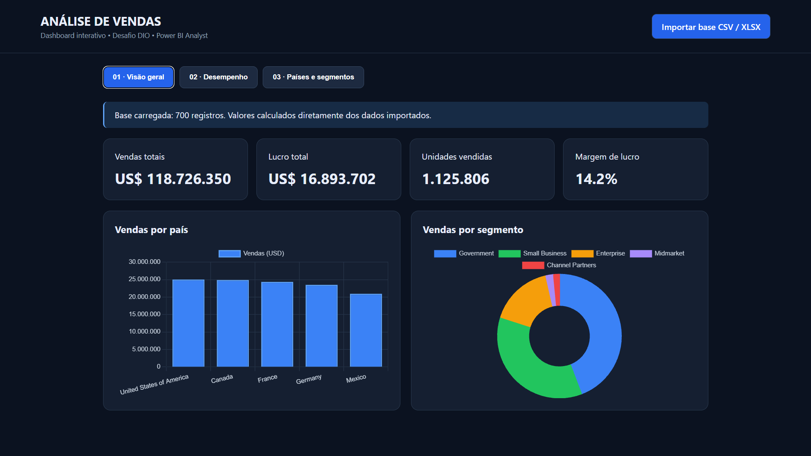
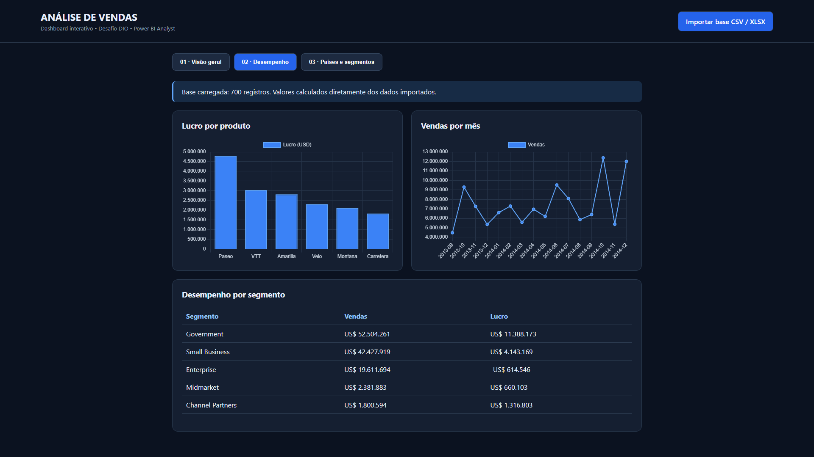
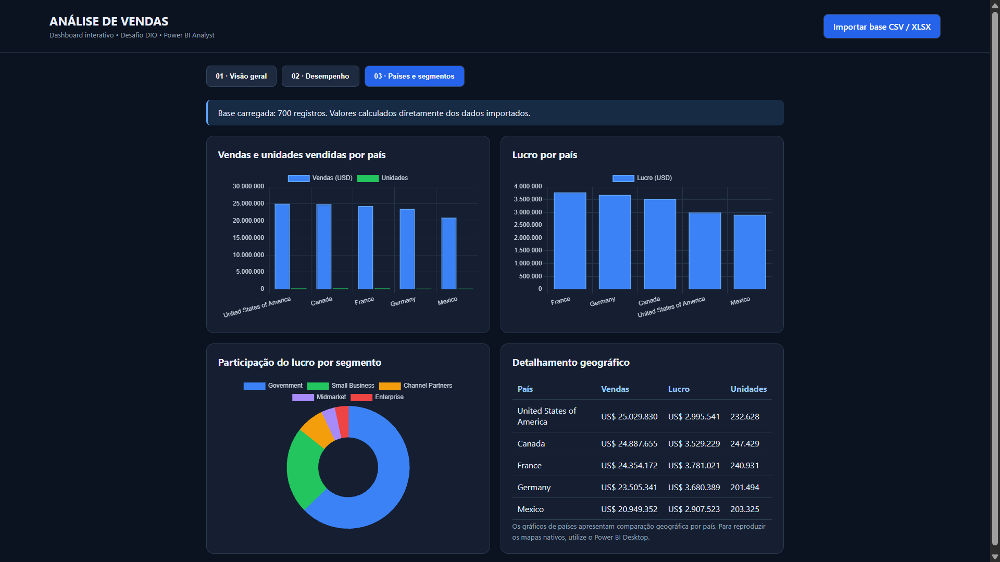

# Dashboard de Análise de Vendas | Power BI Analyst

Projeto desenvolvido como parte do desafio prático da formação **Power BI Analyst**, disponibilizada pela **DIO (Digital Innovation One)**. O objetivo é transformar a base **Financial Sample** em informações visuais para acompanhar vendas, lucratividade, unidades vendidas e desempenho comercial por produto, segmento e país.

## Sobre o projeto

O dashboard foi organizado em **três páginas interativas**, com indicadores, gráficos e tabelas. A implementação apresentada nas imagens é uma **versão web (HTML)**, construída como alternativa visual ao exercício proposto para Power BI. Os dois mapas nativos solicitados no desafio ainda precisam ser reproduzidos no Power BI Desktop para atendimento integral aos requisitos.

### Objetivos

- Analisar o faturamento, o lucro e a margem de lucro.
- Comparar as vendas por país e por segmento.
- Avaliar a rentabilidade dos produtos.
- Acompanhar a evolução mensal das vendas.
- Explorar a distribuição geográfica de vendas, lucro e unidades vendidas.

## Principais indicadores

| Indicador | Resultado |
| --- | ---: |
| Vendas totais | US$ 118.726.350 |
| Lucro total | US$ 16.893.702 |
| Unidades vendidas | 1.125.806 |
| Margem de lucro | 14,2% |

*Valores aproximados, conforme exibidos no dashboard com os 700 registros importados da Financial Sample.*

## Páginas do dashboard

### 1. Visão geral

Apresenta os quatro indicadores principais, um gráfico de vendas por país e um gráfico de distribuição de vendas por segmento.



### 2. Desempenho

Apresenta o lucro por produto, a evolução mensal das vendas e uma tabela comparativa de vendas e lucro por segmento.



### 3. Países e segmentos

Apresenta vendas e unidades por país, lucro por país, participação do lucro por segmento e uma tabela de detalhamento geográfico.

**Observação:** nesta versão web, as comparações por país são exibidas em gráficos de barras. Para a entrega completa do desafio da DIO, devem ser adicionados os dois visuais de mapa no Power BI Desktop.



## Base de dados

Foi utilizada a base **Financial Sample**, com 700 registros e campos como `Country`, `Segment`, `Product`, `Units Sold`, `Sales`, `Profit` e `Date`.

Fonte: [Microsoft — Financial Sample](https://learn.microsoft.com/pt-br/power-bi/create-reports/sample-financial-download).

## Tecnologias e recursos

- **Power BI Desktop:** exploração da base, medidas DAX e construção da versão nativa do relatório.
- **HTML / JavaScript:** implementação da versão web interativa do dashboard.
- **Excel / CSV:** formato de entrada dos dados.
- **GitHub:** documentação e versionamento do projeto.

Medidas DAX utilizadas na construção do relatório no Power BI:

```dax
Total Vendas = SUM('financials'[Sales])
Total Lucro = SUM('financials'[Profit])
Total Unidades = SUM('financials'[Units Sold])
Margem Lucro = DIVIDE([Total Lucro], [Total Vendas], 0)
```

## Como reproduzir

1. Faça o download deste repositório.
2. Abra `index.html` no navegador, caso a versão web esteja incluída no repositório.
3. Clique em **Importar base CSV / XLSX** e selecione a Financial Sample.
4. Explore as três páginas do dashboard.
5. Para a versão nativa, abra o arquivo `.pbix` no Power BI Desktop, caso ele tenha sido adicionado ao repositório.

## Aprendizados

- Importação e organização de dados para análise.
- Construção de indicadores de desempenho (KPIs).
- Utilização de medidas DAX no Power BI.
- Comparação de resultados por país, produto e segmento.
- Organização visual de dashboards para apoiar decisões.

## Referências

- [Repositório de referência — Juliana Zanelatto](https://github.com/julianazanelatto/power_bi_analyst)
- [Documentação Microsoft Power BI](https://learn.microsoft.com/pt-br/power-bi/)

## Autora

**Milla Regina Lopes Vieira**  
[LinkedIn](https://www.linkedin.com/in/milla-regina-468020206/)